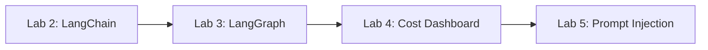

# Практикум по программированию: третий семестр

В папке находятся четыре последовательные лабораторные по RAG. Каждая новая
работа добавляет один учебный слой к предыдущей.

| Работа | Тема | Что показать на защите |
|---|---|---|
| `lab_2_langchain` | LangChain RAG | очистка текста, чанкинг, FAISS + BM25, ответ со ссылками |
| `lab_3_langgraph` | Agentic RAG | маршрутизация по источникам, граф, проверка и повторный поиск |
| `lab_4_costs` | Экономика LLM | типы запросов, опечатки, составные вопросы, стоимость этапов |
| `lab_5_security` | Prompt Injection | обнаружение прямой атаки и удаление заражённых чанков |



## Структура

- `materials/current` — актуальные презентации с заданиями.
- `materials/archive` — более ранние версии презентаций.
- `shared` — общий учебный код: данные, индексы и OpenAI API.
- `scripts` — загрузка данных и построение индексов.
- `data` — исходные данные и индексы; папка исключена из Git.
- `.plans` — планы выполнения работ.

## Где выполнять вычисления

Тяжёлые команды выполняются на сервере:

```bash
ssh home
cd ~/pfur-coursework/intro-to-it/third_semestr
~/miniforge3/bin/mamba run -n main <команда>
```

Используется NVIDIA RTX 4060 Ti 16 GB. Исходники хранятся в Git, а большие
наборы и FAISS-индексы остаются в `data/` на сервере.

## Общий запуск

```bash
~/miniforge3/bin/mamba run -n main python -m pip install -r requirements.txt
~/miniforge3/bin/mamba run -n main python -m scripts.download_data
~/miniforge3/bin/mamba run -n main python -m scripts.build_indexes
~/miniforge3/bin/mamba run -n main streamlit run lab_5_security/app.py
```

Lab 5 содержит все возможности предыдущих работ. Для защиты отдельной темы
запускайте `app.py` из соответствующей папки.

## Настройки API

Модель — `gpt-6-luna`, reasoning effort — `medium` через Responses API.
Для генерации нужен `OPENAI_API_KEY`. Запишите его в `.env` в корне этой папки:

```dotenv
OPENAI_API_KEY=ваш_ключ
```

Приложения читают этот файл автоматически. `.env` не попадает в Git и Docker-образ.
Для синхронизации кода и ключа с сервером выполните `bash scripts/sync_home.sh`.
Содержимое ключа передаётся по SSH, файл имеет права `600`. Без ключа можно
показать загрузку данных, поиск, маршрутизацию, граф и защитные проверки.

Другой вариант — поле «API-ключ OpenAI» в боковой панели или переменная окружения.

Цены Standard API на 09.11.2026: $0.10 / 1M входных, $0.01 / 1M кэшированных
входных, $0.50 / 1M выходных токенов. Reasoning-токены входят в выходные.
Источник: [официальная страница модели](https://developers.openai.com/api/docs/models/gpt-6-luna).
Значения можно изменить через `OPENAI_INPUT_PRICE`, `OPENAI_CACHED_PRICE`,
`OPENAI_OUTPUT_PRICE`. Dashboard использует usage от API, а не оценку по символам.

## План работ

Подробный план: [`.plans/PLAN_course_labs.md`](.plans/PLAN_course_labs.md).
