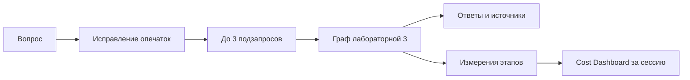

# Лабораторная 4: стоимость запросов

Приложение исправляет близкие опечатки по заголовкам документов, выделяет до
трёх подзапросов и выполняет для каждого граф лабораторной 3. Его маршрутизатор
отделяет разговор от поиска по Хабру, научным статьям или новостям. Поисковая
ветка проверяет найденные фрагменты и ответ, допускает одну коррекцию запроса.



План работы: подготовить индексы, запустить интерфейс, сравнить обычный и
составной вопросы, объяснить маршруты и проверить стоимость серии запросов.

Сначала установите зависимости и загрузите данные по [общей инструкции](../README.md).
Из каталога `intro-to-it/third_semestr`, в окружении `main`:

```bash
mamba run -n main python -m scripts.build_indexes
mamba run -n main streamlit run lab_4_costs/app.py
```

Для генерации задайте `OPENAI_API_KEY` в окружении или боковой панели. Общий
клиент использует GPT-6 Luna с reasoning medium. Без ключа доступен локальный
режим графа; он не подтверждает качество ответа модели и расход API-токенов.
Тяжёлое построение индексов выполняйте на сервере согласно корневому README.

Примеры для защиты:

- «Привет!» — разговорная ветка без поиска.
- «Что такое машинное обучениe?» — исправление зависит от словаря заголовков.
- «Что такое машинное обучение и как его применяют?» — два подзапроса.
- «Какие научные исследования посвящены нейросетям?» — научный источник.
- Выполните несколько вопросов и сравните этапы, отдельные подзапросы и серию.

Dashboard показывает время, входные, выходные и кэшированные токены и расчётную
стоимость по настройкам общего модуля `shared.costs`. Подготовка локальна и имеет
нулевую стоимость API. Каждый запуск имеет общий ID для всех этапов и подзапросов; поле
`subquestion` содержит номер подзапроса (0 для подготовки).
История живёт в Streamlit session_state; перезапуск сервера её не сохраняет.

Ограничения: словарь ограничен первыми 2000 чанками каждого источника и 10000
словами длиной от пяти букв. Исправляется только одно изменение символа; возможны
ложные исправления, поэтому исправленный текст показан пользователю. Разделение
по предложениям и «и как/что/почему» — эвристика, не смысловой анализ. Лишние
части объединяются в третий подзапрос. Ответы показываются отдельно, без общего
синтеза. Самопроверка и маршрутизация наследуют ограничения лабораторной 3.
Расчёт стоимости не заменяет биллинг провайдера; неуспешные запуски в историю
интерфейса не добавляются.

`logic.run_question(question, indexes, api_key=None, document_filter=None)`
возвращает `(results, rows, corrected, subquestions)`. Фильтр передаётся графу
для демонстрации безопасности в лабораторной 5.
